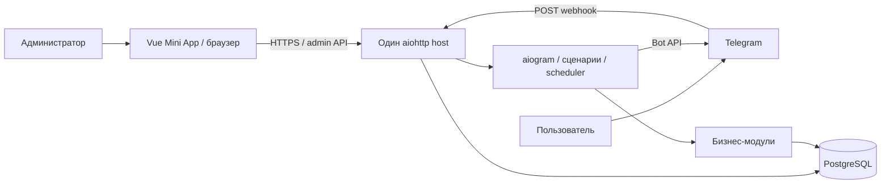

# Архитектура Manashelper и визуальных сценариев

Документ описывает текущую реализацию на 2 ноября 2026 года. Основное внимание —
редактору меню и форм, его связи с Telegram-ботом и Python-делегатами.
Незавершённые изменения перечислены в конце и не выдаются за работающие функции.

Переход описан в [ORCHESTRATION.md](../features/ui_flows/ORCHESTRATION.md):
матрица UI-входов составлена, HTTP/Telegram host перенесён на aiohttp, добавлен
вход в редактор через Telegram Mini App, версионируемый DB-каталог локализации
и единый ingress с опубликованным реестром входов.
Проверки этапов 2–4 фиксируются отдельно от прежней приёмки. Полный перенос UI
в движок и удаление FSM остаются следующими этапами.

## 1. Основная идея

Администратор собирает сценарий в браузере: экраны, тексты, кнопки, ввод и переходы.
Сценарий сохраняется как типизированный JSON-документ. Python-исполнитель читает
опубликованную версию и продвигает пользователя по графу. Бизнес-операции выполняют
заранее зарегистрированные Python-делегаты через существующие сервисы приложения.

Четыре понятия разделены:

| Понятие | Значение |
| --- | --- |
| Сценарий | Описание интерфейса и правил переходов |
| Версия | Неизменяемый опубликованный снимок сценария |
| Сессия | Прохождение конкретного пользователя: версия, шаг, ответы и статус |
| Делегат | Python-функция с явным контрактом входов, выходов и исходов |

Граф управляет диалогом. Сохранение анкет, чтение расписания и прочие бизнес-правила
остаются в соответствующих модулях Manashelper. Внешний BPMN-движок не используется.

## 2. Процессы и связи

`manashelper.main` запускает один Python-процесс: aiohttp host, Bot, Dispatcher,
Dishka APP-container и планировщик. Общий lifecycle закрывает HTTP-приём, фоновые
задачи, scheduler, Telegram session и контейнер с DB/HTTP-ресурсами. PostgreSQL
и HTTPS-прокси остаются отдельной инфраструктурой. Единственный production transport
по умолчанию — webhook; polling выбирается явно для development.

На одном host находятся `POST /telegram/webhook`, административный API
`/admin/api/v1/...`, собранный редактор `/admin/` и минимальный `GET /health`.
Редактор использует Vue 3, TypeScript и Vue Flow; Bun собирает готовый `dist`,
Python раздаёт только index/assets. Отдельных FastAPI/Uvicorn и admin-службы нет.
Административные маршруты включаются при настройке web origin и signing key.
Пользователи взаимодействуют с Telegram; Mini App и браузерный редактор доступны
только настроенному приватному администратору.



Штатная точка запуска применяет Alembic-миграции перед стартом. HTTP-фабрика для
тестов сама не запускает миграции, Bot или jobs. Docker включает собранный frontend
в Python-образ и запускает только сервис `app`; HTTP-порт опубликован на loopback.
HTTPS завершается на прокси перед общим host.

`MANASHELPER_HTTP_HOST` по умолчанию `127.0.0.1`, `MANASHELPER_HTTP_PORT` — `8080`;
в контейнере host задаётся `0.0.0.0`. Для webhook необходим
`MANASHELPER_TELEGRAM_WEBHOOK_SECRET`: 16–256 ASCII-букв, цифр, `_` или `-`.
Development polling включается `MANASHELPER_TELEGRAM_TRANSPORT=polling`.
Приложение не вызывает регистрацию или удаление webhook при старте. Оператор
отдельно проверяет HTTPS/secret и настраивает transport в Telegram, сохраняя pending
updates. Один bot token нельзя одновременно обслуживать через webhook и polling.

## 3. Границы кода

Исходники разделены на три Python-пакета и отдельный frontend:

```text
src/
├── common/                  # Общая SQLAlchemy Base
├── ui_flows/                # Движок без зависимостей от приложения
│   ├── domain/
│   ├── application/
│   └── ports/
├── manashelper/             # Бизнес-функции и интеграционные адаптеры
└── admin-ui/                # Vue-редактор, отдельная Bun-сборка
```

`common` не импортирует приложение или движок. `ui_flows` не импортирует
`manashelper`, aiogram, aiohttp, SQLAlchemy или Dishka. `manashelper` связывает
контракты движка с конкретными адаптерами. Все три Python-пакета входят в одну
дистрибуцию; отдельные сервисы или сетевые вызовы между ними не добавлены.

| Область | Ответственность |
| --- | --- |
| `common/database.py` | Единственная SQLAlchemy Base и общий registry metadata |
| `ui_flows/domain/` | Контракт графа, события, состояние, типы делегатов и доставки |
| `ui_flows/application/` | Исполнитель, публикация, сессии, registry, доставка и очистка |
| `ui_flows/ports/` | Интерфейсы хранилища, использующего транзакцию вызывающего приложения |
| `manashelper/core/` | Конфигурация, engine/session pool, HTTP-клиент, логирование и транзакции |
| `manashelper/platform/telegram/` | Dispatcher, middleware, навигация, аудит и общие правила доставки |
| `manashelper/platform/web/` | aiohttp host, webhook, Mini App initData, bearer/cookie-сессии, Origin/CSRF, assets и REQUEST-транзакции |
| `manashelper/platform/i18n/`, `manashelper/localization/` | DB-каталог и REQUEST-снимки, публикации, импорт, локали и темы; отдельный English admin bundle |
| `manashelper/modules/<feature>/` | Бизнес-сервисы, репозитории, модели, делегаты и представление функции |
| `manashelper/modules/ui_flows/` | PostgreSQL-адаптеры, Telegram/admin API, rollout, seed-документы и DI |
| `manashelper/jobs/` | Регистрация расписания; задания принадлежат своим модулям |

Dishka собирает зависимости. Settings, engine и долгоживущие клиенты обычно имеют
APP scope; сессия БД, репозитории и сервисы с транзакционными зависимостями — REQUEST.
Сервисы возвращают обычные модели данных; ORM-объекты не передаются в представление.

Внутри интеграционного модуля `manashelper/modules/ui_flows`:

- `application/` — политика выпуска и запросы мониторинга с зависимостями от приложения;
- `infrastructure/` — ORM и PostgreSQL-репозитории;
- `presentation/` — Telegram-адаптер, renderer, sender, admin API и preview;
- `provider.py` — DI-композиция зависимостей подсистемы.

Provider связывает `FlowStore`, `DialogStore`, `DeliveryStore`, `LocationStore`
и `MaintenanceStore` с существующими REQUEST-репозиториями через Dishka aliases.
Движок и DB-делегат получают тот же AsyncSession. Перенос пакетов не меняет
таблицы, внешние ключи, индексы, JSON-контракт или Alembic history.

## 4. Как исполняется граф

[`FlowDocument`](../src/ui_flows/domain/schema.py) содержит
стабильные ID узлов, начальный узел, поля формы, начальные данные, тексты, кнопки
и координаты. `layout` влияет на рисунок редактора, но не на исполнение.

| Узел | Поведение |
| --- | --- |
| `menu` | Показывает экран и ожидает кнопку |
| `input` | Принимает текст, целое число или выбор, проверяет ограничения и заполняет поле формы |
| `condition` | Выбирает первую подходящую ветку либо обязательный `default` |
| `action` | Вызывает делегат указанной версии и выбирает переход по его исходу |
| `end` | Завершает/отменяет форму, возвращает в другой сценарий или передаёт управление функции |

[`FlowInterpreter`](../src/ui_flows/application/interpreter.py)
исполняет автоматические узлы до ожидания пользователя или завершения. Лимит —
32 автоматических шага на событие. Внутри исполнителя нет SQL, Telegram-вызовов,
`eval` или динамического импорта Python из JSON.

[`DialogService`](../src/ui_flows/application/dialogs.py)
загружает закреплённую версию, проверяет владельца, ревизию и повтор события,
вызывает исполнитель и сохраняет результат. Один приватный чат имеет не более
одной активной runtime-сессии. Конкурентные изменения защищены advisory lock чата
и ограничением уникальности активной сессии.

## 5. Путь одного события

Пользователь нажимает кнопку или вводит ответ. Router ставит работу runtime в
`AfterRequestActions`: исходный REQUEST с профилем пользователя и аудитом должен
завершиться раньше отдельной транзакции координатора.

```mermaid
sequenceDiagram
    participant TG as Telegram
    participant Router as aiogram Router
    participant C as FlowTelegramCoordinator
    participant DB as PostgreSQL
    participant I as FlowInterpreter
    participant D as Python delegate
    TG->>Router: Update
    Router->>DB: Профиль и аудит; commit исходного REQUEST
    Router->>C: AfterRequestActions
    C->>DB: Блокировка чата; состояние, версия, проверка события
    C->>I: Нормализованное событие и контекст
    opt Встречен узел action
        I->>D: Аргументы по контракту
        D->>DB: Бизнес-операция через сервис в том же REQUEST
        D-->>I: Исход и выходные значения
    end
    I-->>C: Следующее состояние
    C->>DB: Состояние, событие, проекция и screen intent; commit
    C->>DB: Claim доставки; unknown; отдельный commit
    C->>TG: Отправка подготовленного экрана
    C->>DB: Подтверждение sent при успехе
```

[`FlowTelegramCoordinator`](../src/manashelper/modules/ui_flows/presentation/coordinator.py)
связывает application-сервисы, renderer и сеть. HTML и размеры сообщения проверяются
до commit. Бизнес-запись делегата, переход, дедупликация и intent атомарны;
ошибка до фиксации откатывает их вместе. Вложенные savepoint защищают операции
DialogService и при ошибке, перехваченной внешним вызывающим кодом.

Webhook проверяет отдельный `X-Telegram-Bot-Api-Secret-Token`, размер запроса и тип
Update, затем ожидает `Dispatcher.feed_update`. Раннего фонового HTTP 200 нет;
сбой до критического commit не подтверждает Update. Ошибки не поглощаются общим
aiogram error handler. Cookie/CSRF-механизм админки к webhook не применяется.
Сырой Update не записывается в очередь или журнал: он может содержать sensitive input.

## 6. Делегаты и существующие функции

[`DelegateRegistry`](../src/ui_flows/application/delegates.py)
хранит явные пары `(delegate_id, contract_version)`. Перед вызовом он проверяет
состав и типы аргументов, после — исход и выходы. Определение связывается с Python-
обработчиком через `DelegateBinding`.

Сейчас реализованы два делегата в
[`survey_delegates.py`](../src/manashelper/modules/student_questions/survey_delegates.py):

| ID | Действие |
| --- | --- |
| `student_questions.has_submitted` | Читает наличие завершённой анкеты |
| `student_questions.submit` | Сохраняет итоговую анкету через StudentQuestionsService |

Они подключаются в
[`UiFlowsProvider.registry`](../src/manashelper/modules/ui_flows/provider.py).
Переданный `user_id` проверяется против доверенного контекста пользователя.
DB-делегаты используют ту же транзакцию, что переход. Сетевые побочные эффекты
внутри этих делегатов пока не поддерживаются.

Пример реального связывания графа с Python:

```json
{
  "kind": "action",
  "id": "check_submission",
  "delegate": "student_questions.has_submitted",
  "contract_version": 1,
  "arguments": {
    "user_id": {"kind": "ref", "scope": "user", "field": "id"}
  },
  "results": {"submitted": "has_submitted"},
  "outcomes": {"success": "choose_start"}
}
```

Здесь `has_submitted` — объявленное boolean-поле сценария, `choose_start` — следующий
узел. Реализация проверки находится в Python; граф задаёт аргументы и маршрутизацию.

Отдельный механизм — **handoff**: `end` с `feature` закрывает runtime и после commit
и claim вызывает публичный presentation entry point существующего модуля.
[`open_feature`](../src/manashelper/modules/ui_flows/presentation/features.py)
поддерживает девять входов: Food menu, Marketplace, Settings, Schedule, Attendance,
Grades, Study week, Eders и Eders materials. Это не транзакционные Action-делегаты.
Вызовы aiogram handlers и поддельные Update для передачи управления не используются.

## 7. Данные и версии

В PostgreSQL находятся восемь таблиц подсистемы и две таблицы веб-авторизации:

| Таблица | Содержимое |
| --- | --- |
| `ui_flows` | Черновик, его ревизия и указатель опубликованной версии |
| `ui_flow_versions` | Неизменяемые документы публикаций, автор и время |
| `ui_dialog_sessions` | Пользователь, чат, версия, шаг, статус, ревизия и данные формы |
| `ui_flow_events` | Дедупликация по update ID, исходный переход и результирующая сессия при возврате |
| `ui_screen_deliveries` | Подготовленный экран, токен кнопок, результат доставки и message ID |
| `ui_user_locations` | Проекция текущего runtime или последнего legacy-наблюдения |
| `ui_user_transitions` | Общая история переходов без ответов формы |
| `ui_flow_rollout` | Режим запуска admin/all/off и его ревизия |
| `admin_login_tickets` | Хеши одноразовых билетов входа |
| `admin_web_sessions` | Хеши cookie/bearer-сессий и срок действия |

Модели принадлежат своим модулям и регистрируются через `bootstrap.load_models()`;
изменения схемы проходят Alembic. Тексты экрана могут содержать подставленные ответы,
поэтому сессии и delivery snapshots не считаются безопасными данными мониторинга.

**Save** меняет черновик с проверкой `expected_revision`. **Publish** проверяет схему
и отображение и создаёт версию. Новые диалоги используют текущую публикацию;
активный диалог продолжает свою версию. **Activate** переключает указатель на ранее
опубликованную версию, не переписывая черновик или активные сессии.

`return_flow` создаёт новую сессию на текущей публикации цели в одной транзакции
с завершением исходной. Цель должна начинаться с Menu/Input. Ответы исходной формы
не переносятся. `result_session_id` сохраняет корректную дедупликацию этого перехода.

## 8. Доставка и восстановление

Сохранённое состояние и показанное пользователю сообщение — разные факты:

| Статус доставки | Значение |
| --- | --- |
| `pending` | Intent сохранён; попытка ещё не захвачена |
| `unknown` | Claim зафиксирован; результат отправки может быть неоднозначным |
| `sent` | Telegram API подтвердил отправку |
| `failed` | Попытка отклонена либо получатель недоступен для доставки |

`sent` не означает, что пользователь прочитал сообщение. Неопределённая попытка
автоматически не повторяется: Telegram-отправка и commit БД не образуют общую
транзакцию. Явное восстановление перерисовывает текущий шаг без повторения Action.

Inline callback содержит непрозрачный токен delivery и индекс кнопки. Проверяются
пользователь, чат, message ID, статус и ревизия сессии. Reply-кнопки сопоставляются
с сохранёнными показанными подписями; URL-кнопки не продвигают граф.

**Текущее ограничение sender:** inline-экран с кнопками отправляется двумя сообщениями:
текст с ReplyKeyboardRemove, затем «Выберите действие» со всеми inline-кнопками.
Message ID хранится от второго сообщения. Telegram запрещает редактирование
сообщения с ReplyKeyboardRemove. Объединение текста/кнопок и обновление одного
сообщения при переходах обсуждены, но ещё не реализованы.

## 9. Старые формы, мониторинг и rollout

Графом уже представлены главное меню, «Учёба» и студенческий опрос. Остальные
функции продолжают использовать собственные routers, сервисы и aiogram FSM.
Наблюдатель сохраняет только имя успешно завершившегося handler, FSM state и время
после commit исходного REQUEST. FSM data и текст ввода в проекцию не копируются.

В Users различаются `runtime`, `legacy` и `unknown`. Runtime хранится в PostgreSQL;
legacy FSM использует MemoryStorage и после перезапуска становится unknown.
Мониторинг показывает закреплённую версию графа и обновляет видимую страницу раз
в пять секунд. Это наблюдение, а не механизм принудительного перемещения пользователя.

Release меняет допуск **новых** запусков без рестарта:

- `admin` — runtime для настроенного приватного администратора;
- `all` — runtime для приватных пользователей;
- `off` — новые входы обслуживают прежние маршруты.

При Off начатые формы остаются доступными для завершения или отмены. Deep link
опроса может восстановить активный runtime даже при отключённых новых запусках.
Начатые legacy-опросы сохраняют своего владельца. Замена завершённой анкеты требует
подтверждения и сохраняется только после полного нового прохода.

Закрытые payload и старые screens очищаются после семи дней ежедневным заданием.
Активное состояние, бизнес-ответы, версии, история и event receipts сохраняются.
Истёкшие данные веб-авторизации очищаются отдельным заданием.

## 10. Админка, preview и локализация

`/editor` доступен приватному администратору и отправляет кнопку `web_app` с HTTPS
адресом `/admin/`. Mini App запрашивает fullscreen через Telegram SDK, учитывает
viewport/safe areas; неподдерживаемый fullscreen использует fallback `expand()`.
Результат на настоящих Telegram-клиентах требует отдельной ручной приёмки.

Сервер проверяет подпись исходного `initData`, возраст до пяти минут и `user.id`
на совпадение с настроенным администратором. `initDataUnsafe` не авторизует запрос.
Обмен ограничен пятью корректными входами за минуту на host. В ответ выдаётся
восьмичасовой bearer token: клиент хранит его только в памяти и передаёт в
`Authorization`, без URL/localStorage/sessionStorage. БД содержит только digest
от `miniapp:` + token в прежней таблице `admin_web_sessions`; миграция схемы не нужна.
Cookie и bearer credentials не взаимозаменяемы, logout отзывает текущую сессию.

Ссылка обычного браузерного входа сохранена рядом с кнопкой Mini App: одноразовый
билет действует пять минут, передаётся во fragment URL и удаляется до обмена.
Cookie-сессия живёт восемь часов и имеет Secure/HttpOnly/SameSite=Strict. Все
изменяющие browser-запросы требуют точного HTTPS Origin; cookie-запросы дополнительно
требуют CSRF-токен, bearer-запросы обходятся без него. REQUEST завершается до выдачи
HTTP-ответа и credentials, включая cookie: ошибка commit не выдаёт новую сессию.

Preview использует общий интерпретатор, но отдельный registry с явными заглушками.
Реальные делегаты не вызываются, Telegram-сообщения и ответы пользователей не
сохраняются. Preview не изменяет активный диалог реального пользователя.

Интерфейс админки — только EN. Пользовательские тексты и preview поддерживают
EN/RU/KY/TR/ZH. `CatalogText` использует стабильные ключи DB-снимка; `InlineText`
хранит варианты текста внутри версии сценария. Динамические значения экранируются
для Telegram HTML; браузерный preview не исполняет произвольный HTML/JavaScript.

Пользовательские тексты, ошибки, команды и уведомления читают неизменяемый выпуск
из `text_catalog_releases`. `text_catalog_state` хранит черновик, optimistic revision
и текущий выпуск. REQUEST выбирает его один раз; фоновая обработка сохраняет
локаль/тему получателя. Версия сценария закрепляет выпуск, поэтому смена переводов
не изменяет активные формы и исторический preview. Intent сохраняет screen и pin;
доставка после commit использует тот же выпуск. UI публикации/отката находится
во вкладке Texts. Пользовательские runtime-чтения `.mo` отключены; English admin
bundle остаётся файловым. [Модель и совместимость](../features/ui_flows/LOCALIZATION.md).

## 11. Состояние реализации и точки расширения

Telegram adapter преобразует вход в транспортно-независимый `IncomingEvent`.
Единый resolver выбирает один runtime/legacy маршрут по опубликованным bindings,
правам, scope, capabilities и состоянию диалога. Три owned-таблицы сохраняют draft,
immutable manifests и квитанции `(bot_id, update_id)` без текстов, контактов и FSM data.
Manifest закрепляет версии сценариев, тексты и return targets; сессия хранит nullable pin.
Runtime admission коммитится до coordinator; replay сверяется с исходной session/revision.
Legacy handlers и их MemoryStorage продолжают работать за выбранным owning-адаптером.
Оператор публикует тексты, новую ревизию сценария, затем новую ревизию Triggers.
Откат указателя не меняет активные сессии. [Контракт и совместимость](../features/ui_flows/TRIGGERS.md).

Готовы контракты, runtime, PostgreSQL-хранилище, два делегата опроса, Telegram-адаптер,
admin API, Vue-редактор, мониторинг, публикация/откат, rollout и очистка данных.
Добавлены общий aiohttp lifecycle, webhook и Mini App shell/auth; итоговые проверки
этого переноса фиксируются отдельно. Единое редактируемое Telegram-сообщение
**не реализовано**; остальной UI и кеши продолжают использовать legacy FSM.
Полная ручная проверка пользовательского пути остаётся отдельной приёмкой перед
production-включением, включая настоящий webhook и fullscreen на Telegram-клиентах;
локальные тесты и успешная отправка API её не заменяют.

Для новой бизнес-операции нужно реализовать сервис у владельца функции, добавить
Definition/Binding/handler делегата, подключить registry и сослаться на ID/версию
в Action. Для новой формы с уже имеющимися делегатами достаточно нового документа
и его публикации. Несовместимый контракт делегата требует новой версии; обработчики
старых контрактов нужны, пока ими пользуются начатые формы.

Подробности: [контракт сценария](../features/ui_flows/CONTRACT.md),
[runtime](../features/ui_flows/RUNTIME.md), [Telegram](../features/ui_flows/TELEGRAM.md),
[admin API](../features/ui_flows/ADMIN_API.md), [мониторинг](../features/ui_flows/MONITORING.md),
[опрос](../features/ui_flows/SURVEY.md), [включение и откат](../features/ui_flows/RELEASE.md).
