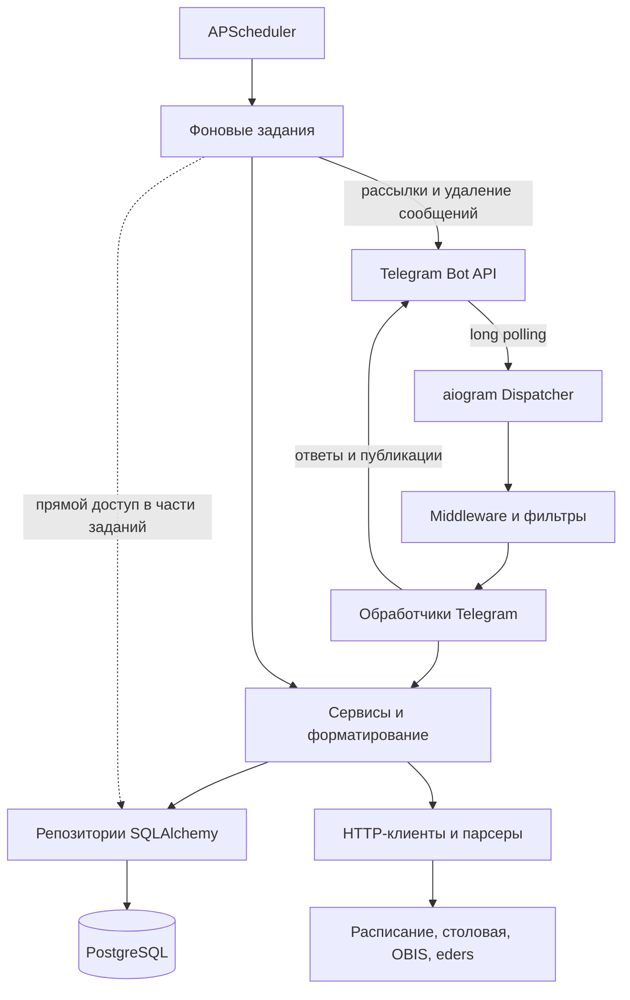

# Структура и архитектура Manashelper

Состояние исходного кода и конфигурации на 25 октября 2026 года. Документ описывает реализацию в текущем
репозитории; наличие функции в `features/` само по себе не означает, что она реализована.

Проект находится в процессе постепенного перехода к функциональным модулям. Перенесены `feedback`,
`advertisements`, `student_questions`, `versions` и `donations`. Код каждой области собран в `modules/`.
У объявлений также перенесена очистка истёкших публикаций. Versions остаётся набором функций без DI provider.
Остальные области пока
сохраняют прежнюю структуру по слоям.
В `modules/users/` пока выделены только публичный UsersQuery и REQUEST-provider: count и список ID
используются пожертвованиями и рассылкой. Остальной код пользователей остаётся в legacy-пакетах.
Карта зависимостей, порядок этапов и исходные проблемы проверок описаны в [MIGRATION.md](MIGRATION.md).

## 1. Назначение и общий подход

Manashelper — Telegram-бот для студентов Кыргызско-Турецкого университета «Манас». Он объединяет расписание,
меню столовой, оценки и посещаемость OBIS, задания и материалы eders, объявления и общение с администратором.
Пользователь работает через команды, reply-клавиатуры и inline-кнопки Telegram.

Архитектурно это асинхронный монолит с постепенным переходом от слоёв к функциональным модулям.
Один Python-процесс принимает обновления
Telegram через long polling и выполняет фоновые задания APScheduler. Постоянные данные хранятся в PostgreSQL.
Собственного REST API, веб-интерфейса, отдельного сервиса фоновых работников и брокера сообщений в текущей
конфигурации нет. Postman в репозитории используется для локальной имитации внешнего eders при тестировании.



Основной путь зависимостей: обработчик вызывает сервис, сервис использует репозиторий или HTTP-клиент,
репозиторий работает с ORM-моделями. Форматтеры и клавиатуры превращают результаты в сообщения Telegram.
Это практическое разделение по слоям: отдельного независимого доменного пакета и интерфейсов для каждого
репозитория здесь нет.

## 2. Технологический стек

| Область | Технология и роль |
| --- | --- |
| Исполнение | Python 3.13+, `asyncio` |
| Telegram | aiogram 3: маршрутизация, фильтры, FSM, клавиатуры, HTML и rich messages |
| Доступ к данным | SQLAlchemy 2 в асинхронном режиме, драйвер `asyncpg` |
| Хранилище | PostgreSQL 17 в Docker Compose |
| Миграции | Alembic |
| Внедрение зависимостей | Dishka, области жизни `APP` и `REQUEST` |
| Фоновые задачи | APScheduler 3, `AsyncIOScheduler` |
| Получение страниц | `httpx.AsyncClient` |
| Разбор HTML | BeautifulSoup и lxml |
| Конфигурация | `pydantic-settings`, переменные окружения и `.env` |
| Шифрование паролей | `cryptography`, AES-GCM |
| Переводы | gettext, Babel, адаптер `CatalogI18n` |
| Разработка | uv, Ruff, mypy в строгом режиме, pytest и pytest-asyncio |
| Доставка | Docker, GitHub Actions, Docker Hub, SSH и Docker Compose |

Декларации зависимостей находятся в [pyproject.toml](../pyproject.toml), зафиксированные версии — в `uv.lock`.

## 3. Структура репозитория

```text
manashelper/
├── src/manashelper/
│   ├── main.py                    # Точка входа и жизненный цикл приложения
│   ├── config.py                  # Настройки окружения
│   ├── di.py                      # Общие и пока не перенесённые зависимости Dishka
│   ├── logging_config.py          # Консольные и файловые логи
│   ├── bot/
│   │   ├── dispatcher.py          # Middleware, маршрутизаторы, обработчик ошибок
│   │   ├── commands.py            # Регистрация команд в Telegram
│   │   ├── callback_data.py       # Типизированные данные inline-кнопок
│   │   ├── routers/               # Обработчики команд, сообщений и callback-запросов
│   │   ├── keyboards/             # Построение клавиатур
│   │   ├── filters/                # В том числе TranslatedText
│   │   └── middlewares/           # Лимиты, порядок обработки, локаль, аудит, доступ
│   ├── services/                  # Сценарии, dataclass-модели, форматтеры, утилиты
│   ├── repositories/              # Запросы и изменения данных через SQLAlchemy
│   ├── db/
│   │   ├── base.py                # DeclarativeBase, engine, фабрика сессий
│   │   └── models/                # ORM-модели и таблицы связей
│   ├── scraping/                  # HTTP-клиенты, HTML-парсеры, проверка URL eders
│   ├── jobs/                      # Фоновые задания и их расписание
│   ├── modules/
│   │   ├── advertisements/
│   │   │   ├── presentation/      # Три router, formatter, callbacks, клавиатуры, Telegram adapter
│   │   │   ├── application/       # Объявления, модерация, контакты, ExpireAdvertisements
│   │   │   ├── domain/            # Статусы объявления и типы медиа
│   │   │   ├── infrastructure/    # Четыре ORM-модели и два репозитория
│   │   │   ├── jobs.py            # Тонкий scheduler entry point
│   │   │   └── provider.py        # Зависимости объявлений в Scope.REQUEST
│   │   ├── student_questions/     # Плоский модуль: router, keyboards, callbacks, service, repository, orm, provider
│   │   ├── versions/              # Плоский модуль: history, formatter, keyboards, callbacks, router
│   │   ├── donations/             # Каталог QR, APP Telegram-кеш, REQUEST service, router, клавиатуры, callback, provider
│   │   ├── users/                 # Пока только публичный UsersQuery и REQUEST-provider
│   │   └── feedback/
│   │       ├── router.py          # FSM, обращения и ответы admin-чата
│   │       ├── keyboards.py       # Кнопка отмены
│   │       ├── callbacks.py       # Неизменный payload feedback:cancel
│   │       ├── service.py         # Application-сценарии и dataclass результатов
│   │       ├── repository.py      # Доступ к обращениям
│   │       ├── orm.py             # Таблица feedback_messages
│   │       └── provider.py        # Зависимости Feedback в Scope.REQUEST
│   ├── localization/              # Локали, gettext-контекст, извлечение ключей
│   └── locales/                   # en, ru, ky, tr, zh: каталоги переводов
├── alembic/
│   ├── env.py                     # Настройка миграций и metadata моделей
│   └── versions/                  # Версии схемы и начальное заполнение справочников
├── tests/                         # Тесты логики, обработчиков, БД и интеграций
│   └── fixtures/eders/            # Обезличенные HTML-примеры
├── postman/
│   ├── mocks/eders/               # Локальный мок внешней системы
│   └── simulations/eders.sim.yaml # Конфигурация HTTP-симуляции
├── docs/
│   ├── ARCHITECTURE.md            # Этот документ
│   ├── MIGRATION.md               # Карта перехода, исходные дефекты и результаты этапов
│   ├── commands/                  # JSON-списки команд и ключей их описаний
│   ├── requisites/                # Изображения банковских QR-кодов
│   ├── versions/                  # История версий для команды /versions
│   └── eders-tracking.md          # Подробности отслеживания eders
├── features/                      # Спецификации, исследования и планы
├── docker/Dockerfile              # Многоэтапная сборка приложения
├── docker-compose.yml             # Приложение и PostgreSQL для развёртывания
├── docker-compose.dev.yml         # Локальный PostgreSQL с портом 5432
├── .github/workflows/ci-cd.yml     # Проверки, сборка и деплой
├── .pre-commit-config.yaml         # Локальные проверки перед коммитом
├── pyproject.toml                 # Пакет, зависимости, настройки инструментов
├── uv.lock                        # Зафиксированные зависимости
├── alembic.ini                    # Конфигурация Alembic
├── babel.cfg                      # Правила извлечения переводимых строк
├── README.md                      # Обзор возможностей и запуск
├── AGENTS.md                      # Рабочие правила проекта
└── CLAUDE.md                      # Архитектурные заметки и история решений
```

Внутри `services/` находятся не только классы сервисов. Там же лежат `*_formatter.py`, модели результатов,
сериализация снимков eders, нормализация текста, работа со временем и HTML. Часть этих модулей зависит от типов
aiogram; слой сервисов целиком не изолирован от Telegram.

## 4. Слои и границы ответственности

### Telegram-слой

[bot/dispatcher.py](../src/manashelper/bot/dispatcher.py) создаёт `Dispatcher`, подключает middleware и
регистрирует маршрутизаторы. Обработчики находятся в `bot/routers/`, `modules/feedback/router.py`
и presentation перенесённых модулей, включая `modules/student_questions/router.py`. Они выбирают сценарий по команде, тексту кнопки,
callback-данным или состоянию FSM. Сервисы передаются через `FromDishka[...]`.

Обработчики управляют диалогом и Telegram-операциями: отправляют и редактируют сообщения, отвечают на нажатия,
публикуют объявления, переключают состояния форм. `bot/keyboards/` строит клавиатуры, а
`bot/callback_data.py` задаёт типизированные payload для inline-кнопок.

Порядок маршрутизаторов значим: aiogram использует первый подходящий обработчик. Сейчас сначала подключены
`student_questions` и `advertisement_contact`, затем общий `start`. Это позволяет обработать
`/start student_questions` и `/start ad_<id>` до обычного приветствия. Остальные маршрутизаторы обслуживают
локаль, расписание, поиск занятий, столовую, OBIS, eders, настройки, пожертвования, телефоны, версии,
объявления, модерацию, рассылку и обратную связь.

### Сервисы

`services/` и application-компоненты перенесённых модулей содержат бизнес-правила:
подписки на курсы, сравнение снимков, настройки уведомлений,
проверку владельца объявления, сохранение учётных данных и подготовку результатов для интерфейса.
Сервисы получают конкретные зависимости через конструктор. Они могут вызывать другие сервисы:
например, `StudyWeekService` объединяет `EdersService` и `ScheduleService`.

Результаты для обработчиков преимущественно представлены обычными dataclass: `CourseSummary`,
`DailyMenuModel`, `ScheduleLessonModel`, `AdvertisementSummary`, `EdersSnapshot` и другие.
ORM-объекты используются внутри сервисов и репозиториев. Форматирование вынесено в отдельные функции.

### Репозитории и база данных

Каждый репозиторий получает `AsyncSession` и выполняет запросы к своей области данных. Например,
`LessonRepository` читает сохранённое расписание, а `EdersRepository` хранит снимки и события уведомлений.
Общая декларативная база и фабрики подключения находятся в [db/base.py](../src/manashelper/db/base.py).

Жизненный цикл сессии принадлежит области `REQUEST` Dishka. Фабрика использует `expire_on_commit=False`.
Отдельного класса Unit of Work нет. При обычном выходе провайдер выполняет `commit`, при исключении
самого commit — `rollback`.

Characterization-тест выявил существующий дефект: исключение из тела request scope передаётся Dishka
в async generator как значение `yield`, которое провайдер игнорирует. Поэтому исключение обработчика
само по себе не вызывает rollback, а финализация доходит до commit. Это фактическое текущее поведение;
перенос Feedback его не меняет. Подробности и тест указаны в `docs/MIGRATION.md`.

### Внешние источники

`scraping/` разделяет получение страниц и их разбор. Клиенты выполняют HTTP-запросы, парсеры преобразуют HTML
в структурированные данные. Сервисы решают, как проверить, сохранить и показать эти данные.
Для eders общие модели находятся в `services/eders_models.py`, поэтому парсер тоже зависит от этого модуля.

### Фоновые задания

`jobs/` связывает планировщик, обновление данных и отправку сообщений. Задания открывают собственные области
`REQUEST`, обычно отдельно для курса или пользователя. Ошибки логируются и по возможности изолируются,
чтобы сбой одного элемента не останавливал весь обход.

Проектное правило направляет jobs к сервисам, однако фактическая реализация смешанная: задания расписания,
OBIS, столовой и удаления сообщений также напрямую получают репозитории. `jobs/common.py` содержит общие
операции отправки, определения локали и пакетного удаления сообщений.

Очистка объявлений уже следует целевой границе: `modules/advertisements/jobs.py` открывает request scope,
передаёт адаптер удаления публикаций и вызывает `ExpireAdvertisements.execute()`. Application-сценарий
работает со своим репозиторием и протоколом `PublicationRemover`, без aiogram и Telegram HTML.
Адаптер в `presentation/publications.py` сохраняет пакетное удаление до 100 ID и best-effort обработку
ошибок Telegram, используя пока общий helper из `jobs/common.py`.

## 5. Внедрение зависимостей и запуск

[di.py](../src/manashelper/di.py) содержит общие `AppProvider` и `RequestProvider`.
Отдельный [FeedbackProvider](../src/manashelper/modules/feedback/provider.py) регистрирует репозиторий и
сервис обращений. [AdvertisementsProvider](../src/manashelper/modules/advertisements/provider.py)
регистрирует два репозитория, три сервиса и сценарий очистки. Их зависимости имеют `Scope.REQUEST`;
`PublicationRemover` для очистки передаётся из контекста её entry point. `StudentQuestionsProvider` регистрирует
репозиторий и сервис опроса в том же REQUEST scope. `UsersProvider` предоставляет публичные запросы
пользователей. `DonationsProvider` регистрирует QR-адаптер в `APP` и application-сервис в `REQUEST`.
Семь провайдеров собираются в `main.py`; состояние LRU-кеша сохраняется между request scopes.

| Область | Объекты | Время жизни |
| --- | --- | --- |
| `APP` | `Settings`, engine, фабрика сессий, общий HTTP-клиент, клиенты источников, `FoodMenuParser`, `CryptoService`, `DonationQrService` | Всё время работы приложения |
| `REQUEST` | `AsyncSession`, репозитории, большинство сервисов | Обработка обновления или явно открытая область фонового задания |

Общий `httpx.AsyncClient` имеет таймаут 15 секунд и используется клиентами столовой и расписания.
Объекты `ObisClient` и `EdersClient` живут в `APP`, но создают отдельные короткоживущие HTTP-сессии для
получения персональных данных. Постоянная авторизованная сессия студента между вызовами не хранится.

При запуске `python -m manashelper.main` выполняются следующие действия:

1. Alembic обновляет схему до `head`. Настройки подключения берутся из `Settings`.
2. Настраиваются консольный и файловый логи. Это делается после миграций, поскольку Alembic меняет logging.
3. `asyncio.run(main())` запускает цикл событий и устанавливает обработчик необработанных исключений.
4. Создаются `Bot` с режимом HTML и контейнер Dishka.
5. Создаётся диспетчер. Вызываются `setup_dishka(container, dispatcher)` и явный `inject_router(dispatcher)`.
6. Создаётся и запускается APScheduler.
7. В Telegram регистрируются команды для языков и областей чатов.
8. Начинается `dispatcher.start_polling(...)`.

`AsyncExitStack` организует остановку планировщика, закрытие контейнера и сессии бота. Контейнер также
освобождает engine и общий HTTP-клиент. Миграции вызываются в блоке `__main__`, а не внутри `main()`.

## 6. Обработка обновлений и состояние диалога

Для сообщений и callback-запросов зарегистрированы следующие механизмы:

| Компонент | Назначение |
| --- | --- |
| `RateLimitMiddleware` | Token bucket на чат: ёмкость 10, восстановление 1 токен/с; отклоняет лишние события до ожидания блокировки |
| `PerChatOrderingMiddleware` | `asyncio.Lock` на чат; последовательно выполняет события внутри своего экземпляра middleware |
| Интеграция Dishka | Создаёт область обработки и передаёт контейнер зависимостей |
| `LocaleMiddleware` | Определяет пользователя и локаль, устанавливает gettext-контекст до фильтров и обработчика |
| `PrivateChatOnlyMiddleware` | Проверяет флаг обработчика `private_chat_only` после выбора обработчика |
| `ActionLogMiddleware` | Записывает обработанные сообщения и callback-данные в `action_logs` |

`LocaleMiddleware` подключается после `setup_dishka`, поскольку использует контейнер из middleware data.
Проверка личного чата и аудит — inner middleware: им нужны флаги уже найденного обработчика.
Аудит расположен после проверки доступа, поэтому отклонённые ею события не записываются.

Важная граница: для `message` и `callback_query` создаются отдельные экземпляры лимитера и блокировок.
Следовательно, это не единая блокировка для всех типов обновлений одного чата. Блокировки также не
координируют фоновые задания и другие процессы. Для снимков eders дополнительно применяется блокировка
строки пользователя через `SELECT ... FOR UPDATE` в `EdersRepository`.

`Dispatcher()` использует FSM с хранением в памяти процесса. Формы OBIS, объявления, обратная связь,
опросы и другие многошаговые сценарии используют `FSMContext`. После перезапуска незавершённые диалоги
и временные страницы результатов теряются; завершённые данные в PostgreSQL сохраняются.

## 7. Функциональные области и потоки данных

### Каталог, расписание и поиск занятий

`FacultyService`, `DepartmentService` и `CourseService` показывают иерархию факультетов, отделений и курсов.
Здесь `Course` обозначает курс обучения внутри отделения, а не отдельный учебный предмет. Подписки
пользователей на курсы записываются в `user_courses`.

`TimetableSyncService` получает HTML для курса, разбирает временные слоты и сравнивает их с `lessons` по
паре «день недели, диапазон времени». Изменения сохраняются в `lesson_history`, а job уведомляет подписчиков
с включённой настройкой. Первая загрузка заполняет базу без уведомлений об изменениях.

`ScheduleService` читает расписание выбранных курсов из БД. `LessonSearchService` ищет по сохранённым
занятиям; `normalized_content` и нормализация турецких букв помогают сопоставлению текста.
Форматтеры группируют соседние занятия и выделяют текущий или следующий блок.

### Столовая

`FoodMenuSyncService` получает меню сайта и сохраняет дни и блюда. `DailyMenuService` возвращает доступные
даты, блюда, фотографии, калорийность, просмотры и оценки. Оценка меню имеет диапазон 1–5.
Telegram-слой строит rich messages с кнопками оценки и настроек.

Рассылка меню учитывает день недели и отдельные настройки обеда и ужина. Автоудаление сообщений настраивается
на уровне чата, включая группы: 15 минут, 45 минут, 3 часа, сутки или отключение. Значение по умолчанию —
3 часа. `MessageDeletionService` записывает задания в БД, а отдельная job удаляет просроченные сообщения.

### OBIS

Форма подключения собирает номер студента и пароль. `ObisService.save_credentials()` сначала выполняет
реальный вход через `ObisClient`, затем шифрует пароль с помощью `CryptoService` и сохраняет его у пользователя.
При запросе оценок или посещаемости пароль расшифровывается, создаётся новая HTTP-сессия и выполняется вход.
`obis_parser.py` разбирает страницы, а сервис возвращает модели результатов.

`ObisNotificationService` сравнивает результаты с сохранёнными оценками и посещаемостью. Первое наблюдение
создаёт исходное состояние без уведомлений. Общие переключатели расписания, оценок и пропусков находятся
в `NotificationSettings`; отсутствие строки означает, что все три включены.

### Eders и учебная неделя

`EdersService` использует сохранённые учётные данные OBIS. `EdersClient` выполняет вход OBIS и переход
в eders через SSO с одной cookie jar. Затем получает список курсов через Moodle AJAX с пагинацией,
читает страницы курсов и подробности заданий и тестов. При истечении сессии весь снимок повторяется один раз;
частичный результат не возвращается как успешный снимок.

Парсер поддерживает задания, тесты, файлы, папки, ссылки, форумы и текстовые блоки. `EdersTrackingService`
сравнивает персональные снимки, планирует события и сохраняет их в очередь PostgreSQL. Снимки сериализуются
модулем `eders_serialization.py`. Состояние включает маркер учётных данных и настройки отслеживания.

Доступные сценарии:

- `/eders` — задания и тесты с фильтрами по срокам и статусам;
- `/materials` и `/materials текст` — каталог и текстовый поиск по материалам;
- `/eders_settings` — напоминания за 24 и 2 часа, открытия, переносы сроков и изменения материалов;
- `/week` — семь дней расписания, сроки, открытия и впервые обнаруженные материалы через `StudyWeekService`.

Первый снимок аккаунта, появление нового курса и обновление старого формата снимка не вызывают рассылку
истории материалов. Будущие напоминания при этом создаются. Неопределённые и конфликтующие даты показываются
явно и не используются для напоминаний. Содержимое файлов, изменения внутри папок и новые сообщения форумов
не отслеживаются. Подробности реализации: [eders-tracking.md](eders-tracking.md).

### Объявления и контакты

`AdvertisementService` создаёт объявления со статусом `pending`, проверяет владельца и ограничивает
публикации пятью объявлениями в час. Форма поддерживает медиа. `AdvertisementModerationService` переводит
объявление в `published` или `rejected`; Telegram-операции выполняют обработчики.
Все эти компоненты принадлежат `modules/advertisements/`. Application возвращает dataclass-результаты,
presentation использует enum из `domain/enums.py`, не импортируя ORM-модели.

Модерация разрешена в чате `Settings.moderation_chat_id`, без пользовательских ролей в БД. Одобренные
объявления публикуются в заданный канал. Контакты открываются через `/start ad_<id>`:
`AdvertisementContactService` проверяет опубликованный статус, регистрирует просмотр и получает контакты
владельца через `UserContactService`. Номера телефонов сохраняются отдельно от Telegram username.

Идентификаторы сообщений канала хранятся в `advertisement_channel_messages`, чтобы удалить публикации
при удалении объявления владельцем или истечении срока. Меню барахолки доступно из основной клавиатуры
и через `/start market`.

При истечении срока application-сценарий сначала удаляет публикации через адаптер, затем строку объявления.
Ошибки Telegram при удалении остаются best effort. Существующее поведение модерации также сохранено:
статус `published` устанавливается до отправки в канал; при ошибке публикации автоматической компенсации
нет. Это отдельно зафиксировано тестом, а не исправлено скрытно в ходе переноса.

### Остальные сценарии

| Возможность | Реализация |
| --- | --- |
| Обратная связь | `modules/feedback/`: `FeedbackService` сохраняет обращение и связь с сообщением в admin-чате; администратор отвечает штатным reply Telegram |
| `/broadcast` | Legacy `BroadcastService` получает ID всех пользователей через публичный UsersQuery; доступ проверяется по `admin_chat_id` |
| Опрос студентов | `modules/student_questions/`: `/start student_questions`, FSM-форма и `StudentQuestionsService`; ответы и согласие на beta сохраняются в БД, повторная отправка требует выбора перезаписи |
| `/donate` | `modules/donations/`: каталог QR из `docs/requisites/`, application-счётчик через UsersQuery и APP-адаптер с LRU до 32 Telegram file ID |
| `/versions` | `modules/versions/`: чтение Markdown-файлов из `docs/versions/` при каждом вызове; без таблицы версий и отдельного provider |
| Язык и настройки | `LocaleService`, сервисы общих уведомлений, рассылки меню и очистки сообщений |

## 8. Постоянные данные

ORM-модели находятся в [db/models/](../src/manashelper/db/models/), `modules/feedback/orm.py`,
`modules/student_questions/orm.py` и `modules/advertisements/infrastructure/`. Общий `db/models/__init__.py`
импортирует и повторно экспортирует модели перенесённых модулей, поэтому Alembic
продолжает видеть всю metadata. Основные таблицы сгруппированы ниже.

| Область | Таблицы | Содержимое и связи |
| --- | --- | --- |
| Пользователи | `users`, `user_phone_numbers` | Telegram ID, имя, username, локаль, номер студента, зашифрованный пароль, контактные телефоны |
| Каталог и подписки | `faculties`, `departments`, `courses`, `user_courses` | Факультет содержит отделения, отделение — курсы; пользователь может отслеживать несколько курсов |
| Расписание | `lessons`, `lesson_history` | Текущие слоты курса и история изменений; текущий слот уникален по курсу, дню и времени |
| Меню | `daily_menus`, `dishes`, `daily_menu_dishes`, `daily_menu_ratings` | Меню дня, блюда, связь многие-ко-многим и пользовательские оценки |
| Настройки | `notification_settings`, `food_menu_notification_settings`, `food_menu_cleanup_settings` | Общие переключатели, рассылка по дням и приёмам пищи, автоудаление по chat ID |
| История OBIS | `user_exam_grades`, `user_lesson_attendance` | Последние известные значения для обнаружения изменений |
| Eders | `eders_states`, `eders_notifications` | Снимок и настройки пользователя; события с ключами, временем отправки, сроком исполнения и признаком отмены |
| Объявления | `advertisements`, `advertisement_media`, `advertisement_channel_messages`, `advertisement_contact_views` | Карточки, медиа, сообщения канала и открытия контактов |
| Обратная связь | `feedback_messages` | Обращения и идентификатор соответствующего сообщения администратора |
| Опрос | `student_questions_responses` | Одна текущая запись ответов на пользователя |
| Отложенное удаление | `scheduled_message_deletions` | Сообщения Telegram, которые нужно удалить в заданное время |
| Аудит | `action_logs` | Обработанные сообщения и callback-запросы |

Изменения схемы оформляются миграциями в `alembic/versions/`; `alembic/env.py` использует `Base.metadata`
и настройки приложения. В миграциях также есть начальное заполнение факультетов, отделений и курсов.
Пересоздание таблиц на каждом запуске не выполняется.

## 9. Планировщик и доставка уведомлений

Расписание задано в [jobs/scheduler.py](../src/manashelper/jobs/scheduler.py). Часовой пояс планировщика —
`Asia/Bishkek`. Интервальные задания получают `next_run_time=now` и впервые запускаются сразу после старта.

| Задание | Периодичность | Назначение |
| --- | --- | --- |
| `sync_daily_menus_job` | Каждые 10 минут | Обновление меню |
| `broadcast_lunch_menu_job` | Ежедневно в 11:00 | Рассылка меню обеда |
| `broadcast_dinner_menu_job` | Ежедневно в 17:00 | Рассылка меню ужина |
| `poll_obis_notifications_job` | Каждый час | Изменения оценок и посещаемости |
| `poll_eders_job` | По умолчанию каждые 30 минут | Снимки eders и доставка накопленных событий |
| `sync_timetable_job` | Каждый час | Обновление расписания всех курсов и уведомления подписчиков |
| `cleanup_scheduled_message_deletions_job` | Каждые 5 минут | Пакетное удаление сообщений, срок которых наступил |
| `cleanup_expired_advertisements_job` | Каждый час | Удаление истёкших объявлений и публикаций |

Для eders можно задать интервал от 15 до 60 минут. Если значение `Settings.eders_poll_minutes` равно `None`,
задание не регистрируется. Оно использует `max_instances=1` и `coalesce=True`, чтобы не запускать несколько
экземпляров одного задания и объединять пропущенные срабатывания в пределах этого планировщика.

Гарантии доставки различаются:

- **Eders:** событие сохраняется в БД и отмечается отправленным после успешного вызова Telegram.
  Ошибка отправки оставляет его для следующей попытки. Сбой между отправкой и commit может вызвать повтор.
- **Расписание и OBIS:** состояние сравнивается и сообщения отправляются в ходе job; отдельной постоянной
  очереди повторной доставки для них нет. Ошибка Telegram логируется, но состояние может быть сохранено.
- **Удаление сообщений:** задания удаляются из БД после обработки даже при ошибке Telegram. Бесконечного
  повторения попыток удалить уже отсутствующее или недоступное сообщение нет; размер пакета — до 100 ID.

Планировщик встроен в процесс и не использует постоянное хранилище расписания APScheduler. Сохраняемые события
eders и задания удаления — отдельные прикладные таблицы, которые переживают перезапуск приложения.

## 10. Интеграции и безопасность данных

| Источник | Адрес в коде | Способ работы |
| --- | --- | --- |
| Расписание | `http://timetable.manas.edu.kg/department-printer/{course_id}` | HTML по идентификатору курса |
| Столовая | `https://beslenme.manas.edu.kg/menu` | HTML меню |
| OBIS | `https://obistest.manas.edu.kg` | Вход с CSRF, чтение `/vs-ders/taken-grades` и `/vs-ders/taken-lessons` |
| Eders | `https://eders.manas.edu.kg` | SSO из OBIS, чтение Moodle AJAX и HTML |
| Telegram | Через aiogram | Получение обновлений, ответы, каналы, рассылки и удаление сообщений |

Это адреса, заданные в исходниках, а не результат проверки доступности внешних сайтов.

`CryptoService` шифрует пароль OBIS алгоритмом AES-GCM со случайным nonce длиной 12 байт. Результат
с nonce хранится в base64, ключ берётся из `OBIS_ENCRYPTION_KEY`. Пароль нужен для повторного входа,
поэтому используется обратимое шифрование. Потеря или замена ключа без переноса данных нарушает
расшифровку сохранённых паролей.

Обработчик ввода пароля помечен `mask_logged_message`: аудит сохраняет `[masked]`. Обработчик также пытается
удалить исходное сообщение с паролем из Telegram. Остальной аудит может содержать пользовательский текст;
`action_logs` и технический файловый лог — разные механизмы.

Доступ к личным сценариям ограничивается флагами обработчиков, к модерации и административным действиям —
настроенными ID чатов. Проверка владельца объявления и телефонного номера выполняется сервисами.
Динамический текст для HTML-сообщений экранируется через `services/html_sanitization.py::escape_html`.

Интеграция eders предназначена для чтения. Она не отправляет формы сдачи работ, запуска тестов или изменения
профиля. POST к Moodle используется для получения списка курсов. URL для публичных карточек обрабатываются
через `eders_urls.py`; ключи сессии не должны попадать в сохранённые публичные ссылки и сообщения.
`EdersClient._request` проверяет разрешённый адрес перед каждым HTTP-запросом, включая redirect-цели.
SSO и чтение имеют разные списки разрешённых адресов; небезопасные действия блокируются до обращения к ним.

## 11. Локализация и команды

Поддерживаются пять языков: русский (`ru`), кыргызский (`ky`), английский (`en`), турецкий (`tr`) и
упрощённый китайский (`zh`). Сохранённая локаль пользователя имеет приоритет; иначе используется язык
Telegram с запасным русским. Для отсутствующих переводов `CatalogI18n` подключает английский каталог.
Это два разных механизма: выбор языка и подстановка отсутствующего перевода.

Строки хранятся в `locales/<locale>/LC_MESSAGES/` под стабильными ключами. `.po` находятся в Git,
скомпилированные `.mo` создаются при подготовке окружения и сборке Docker. Фильтр `TranslatedText`
позволяет обработчикам распознавать подписи reply-кнопок с учётом перевода.

При отправке другому пользователю сообщение форматируется в контексте его локали. Фоновые задания
дополнительно устанавливают `i18n.context()`. Общие admin/moderation-чаты и канал объявлений используют
`DEFAULT_LOCALE`, то есть русский.

Списки команд находятся в `docs/commands/private.json`, `group.json` и `admin.json`.
`services/bot_commands.py` читает JSON и переводит описания, а `bot/commands.py` регистрирует команды
по языкам и областям чатов. `/broadcast` регистрируется только для `admin_chat_id`; это дополняет
проверку доступа в обработчике. `babel.cfg` включает извлечение ключей описаний из JSON.

## 12. Конфигурация, развёртывание и логи

[config.py](../src/manashelper/config.py) читает `.env` и окружение. `get_settings()` кешируется через `lru_cache`.

| Переменные | Назначение |
| --- | --- |
| `TELEGRAM_BOT_TOKEN` | Токен бота |
| `DATASOURCE_HOST` | Хост PostgreSQL; по умолчанию `db`, для локального процесса обычно `localhost` |
| `DATASOURCE_NAME`, `DATASOURCE_USERNAME`, `DATASOURCE_PASSWORD` | База и учётные данные; порт подключения в коде — 5432 |
| `OBIS_ENCRYPTION_KEY` | Ключ AES-GCM в base64 |
| `ADVERTISEMENT_CHANNEL_ID`, `ADVERTISEMENT_CHANNEL_LINK` | Канал объявлений |
| `MODERATION_CHAT_ID`, `ADMIN_CHAT_ID` | Чаты модерации и административных действий |
| `EDERS_POLL_MINUTES` | Необязательный интервал eders, по умолчанию 30 минут |
| `VERSION` | Тег Docker-образа в production Compose; не поле `Settings` |

`docker-compose.dev.yml` поднимает только PostgreSQL и публикует порт 5432 на машине разработчика.
`docker-compose.yml` поднимает PostgreSQL и готовый образ `usbtypec1/manashelper:${VERSION}`. База хранится
в томе `postgres_data`, технические логи приложения — в `app_logs`.

Dockerfile устанавливает зависимости через `uv sync --frozen --no-dev`, копирует исходники, миграции и
runtime-файлы из `docs/commands`, `docs/requisites`, `docs/versions`, затем компилирует переводы.
Финальный образ работает от `appuser` и запускает `python -m manashelper.main`.

Текущий [.github/workflows/ci-cd.yml](../.github/workflows/ci-cd.yml) запускает проверки на pull request
в `main` и push тега `v*`. После успешных проверок тега собираются образы с номером версии и `latest`,
публикуются в Docker Hub, затем по SSH обновляется Docker Compose на сервере. Обычный push ветки
в текущих триггерах workflow не указан.

`logging_config.py` пишет события уровня INFO и выше в консоль и `logs/manashelper.log`.
Ротация ограничена примерно 50 МиБ на файл с двумя резервными копиями, то есть примерно 150 МиБ суммарно.
Есть обработчики ошибок обновлений aiogram, исключений цикла событий и фатального завершения приложения.

## 13. Проверки и рабочий цикл

В `tests/` проверяются сервисы и репозитории, обработчики и FSM, middleware, форматирование и экранирование,
локализация, синхронизация и уведомления. Для БД используется настоящий PostgreSQL. Фикстура из
`tests/conftest.py` создаёт внешнюю транзакцию и savepoint; изменения откатываются после теста даже при
внутреннем `commit` тестируемого кода.

Парсеры и сценарии eders проверяются на HTML-примерах. Дополнительный корпусный тест читает локальную
выгрузку из `EDERS_HTML_DIR` или `r` и пропускается, если файлов нет. HTTP-тест
`tests/test_eders_http_flow.py` использует локальную Postman Simulation и запускается при заданном
`EDERS_SIMULATION_PORT`; без него тесты этого модуля пропускаются. Симуляция не входит в production Compose.

Базовые команды из корня проекта:

```sh
uv sync
docker compose -f docker-compose.dev.yml up -d db
uv run pybabel compile -d src/manashelper/locales
uv run alembic upgrade head
uv run python -m manashelper.main
```

Перед миграциями и запуском нужны обязательные настройки из таблицы выше. Для локального процесса следует
задать `DATASOURCE_HOST=localhost`. Проверки БД выполняются только против базы разработки.

```sh
uv run ruff check .
uv run ruff format --check .
uv run mypy src/manashelper
uv run pytest
```

Ruff использует длину строки 120 и целевую версию Python 3.13; mypy проверяет `src/manashelper` в строгом
режиме. Pre-commit содержит Ruff lint, форматирование и mypy. CI дополнительно компилирует переводы,
применяет миграции и выполняет тесты с PostgreSQL.

## 14. Границы текущей реализации

- Развёртывание рассчитано на один экземпляр приложения. FSM, middleware-блокировки, лимиты и кеш QR-кодов
  находятся в памяти процесса; распределённой координации планировщиков нет.
- Telegram-операции и commit PostgreSQL не составляют общую атомарную транзакцию. Возможны частично
  выполненные внешние действия; очереди и правила повторов различаются по сценариям.
- Request provider пока не откатывает транзакцию при исключении тела области Dishka; это отдельный
  зафиксированный дефект, который нельзя считать исправленным структурным переносом Feedback.
- Сроки eders зависят от подтверждённого часового пояса источника. Неизвестное время не заменяется
  предположением ради напоминания.
- Формат HTML внешних сайтов является частью фактической зависимости: изменение страниц может потребовать
  обновления парсеров и тестовых примеров.
- `features/` содержит историю требований и планы. Например, `RAG_KNOWLEDGE_BASE.md` явно описывает план
  без реализации; наличие опроса студентов не означает наличия RAG или LLM-подсистемы.
- Старые описания могут расходиться с кодом: в текущей реализации пять языков, отсутствуют роли
  пользователей для модерации, а деплой запускается по тегам `v*`.

Для перенесённой feature код и зависимости изменяются внутри `modules/<feature>/`; новый provider
подключается в composition root. Остальные области пока используют `bot/routers/`, `services/`,
`repositories/` и `di.py`. Общая Telegram-навигация, i18n, `LocaleService`, `Settings` и `db.base.Base`
остаются временными внешними зависимостями перенесённых модулей. Объявления используют `UserContactService`
через application-поверхность, без доступа к репозиториям Users. Donations и Broadcast используют UsersQuery
из частично выделенного `modules/users/`. Старые Python-пути Feedback, объявлений, опроса, версий и Donations удалены;
адаптеров совместимости для них нет, все потребители в проекте используют новые импорты.

Новый маршрутизатор подключается в `bot/dispatcher.py`, job — в `jobs/scheduler.py`, изменение схемы —
через модели и Alembic. Перенос моделей Feedback, объявлений и опроса сохранил DDL всех 27 таблиц и индексов, поэтому новой
миграции нет. Пользовательские строки добавляются во все пять каталогов; новая публичная команда также
требует записи в соответствующем JSON из `docs/commands/`.
