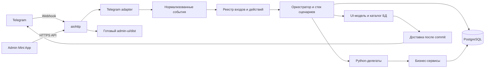

# План перехода всего UI на оркестратор

Статус: этапы 1–4 выполнены 2026-11-02: [матрица UI-входов](INVENTORY.md), общий aiohttp host,
защищённый webhook, Mini App, [DB-каталог текстов](LOCALIZATION.md) и
[единые события, triggers и launch policy](TRIGGERS.md).
Этапы 5–6 реализуют v2-композицию, typed data, snapshots, внешние эффекты и rich delivery.
Реализован срез этапа 7: Settings и вызовы выбора locale/theme, включая durable
interrupt активного runtime. Итоговая приёмка этапа фиксируется после полного прогона
в [PROGRESS.md](../../PROGRESS.md). Остальные feature UI/FSM сохраняются.
По уточнённым пользовательским требованиям legacy-анкета сохраняется для уже
начатых форм и fallback; её удаление не является условием этапа 7.
Локальные проверки описаны в [RELEASE.md](RELEASE.md); live webhook/fullscreen требуют отдельной приёмки.
Документ продолжает [первоначальный план редактора](../UI_FLOW_EDITOR_PLAN.md)
и учитывает перенос движка в `src/ui_flows/`. Текущее устройство описано отдельно
в [ARCHITECTURE.md](../../docs/ARCHITECTURE.md).

## 1. Зафиксированная цель

Оркестратор владеет всей пользовательской навигацией и обработкой взаимодействий:
командами, deep link, inline/reply-кнопками, вводом, контактами, медиа, пагинацией
и подтверждениями. UI строится из небольших переиспользуемых сценариев. Они вызывают
зарегистрированные Python-делегаты с явными входными и выходными контрактами.

В конечной системе:

- aiogram остаётся Telegram-клиентом, парсером Update и транспортным адаптером;
- aiogram FSM, FSMContext, StateFilter, StatesGroup и MemoryStorage не используются;
- положение пользователя, контекст экранов и незавершённая работа хранятся в БД;
- все пользовательские тексты, включая ошибки и уведомления, берутся из БД
  в пяти языках и темах согласно [LOCALIZATION.md](LOCALIZATION.md);
- один Python-процесс на aiohttp обслуживает webhook, admin API, Mini App,
  оркестратор, доставку и планировщик;
- FastAPI, Starlette и Uvicorn удаляются после переноса HTTP-контрактов;
- EN-админка запускается внутри Telegram как Mini App и запрашивает fullscreen;
- `src/admin-ui/` заранее собирается Bun; Python раздаёт только готовый `dist`.

Один процесс означает одну развёртываемую Python-службу. PostgreSQL и HTTPS-прокси
остаются отдельной инфраструктурой. Bun нужен на стадии сборки frontend.

## 2. Что уже есть и чего не хватает

Уже реализованы контракты v1/v2, Call/Return/Replace, pinned dependencies,
PostgreSQL-сессии и frames, transactional/external delegates, дедупликация update,
screen intents, preview, редактор и мониторинг. Settings вызывает переиспользуемые
сценарии locale/theme; глобальный preference-вход приостанавливает текущий runtime.

| Область | Текущий предел | Требуемое расширение |
| --- | --- | --- |
| Входы | Единый resolver и версионируемый DB-реестр, runtime/legacy admission | Этап 4 выполнен; тела legacy-форм ещё у прежних владельцев |
| Граф | Typed collections, динамические actions, Call/Return/Replace | Перенос owning feature-сценариев |
| Делегаты | read/database_write и durable external operations | Feature adapters сохраняют прежние business invariants |
| Контекст | Приватный чат, durable Calls и preference interrupts | Разрешённые групповые действия и остальные legacy-формы |
| Экран | Текст, клавиатура, chunks, фото/альбом и message IDs | Feature pagination/edit/ephemeral semantics |
| Локализация | InlineText и полный версионируемый каталог в БД | Этап 3 выполнен; новые UI-сценарии используют тот же каталог |
| Запуск | Общий lifecycle aiohttp и webhook, явный dev polling | Foundation выполнен на этапе 2 |
| Админка | Mini App с initData/bearer, SDK fullscreen и browser fallback | Foundation выполнен; live client acceptance отдельно |

Существующий `end.feature` передаёт управление старому presentation entry point.
Он остаётся временным мостом на время миграции. В конечной архитектуре все такие
переходы заменяются сценариями и делегатами.

### Инвентаризация FSM

В текущем коде найдены восемь StatesGroup и 22 объявленных State:

| Владелец | StatesGroup | Что перенести |
| --- | --- | --- |
| OBIS | ObisCredentialsForm: 2 | Номер студента, пароль, ошибки и повтор ввода |
| Users | PhoneNumberForm: 1 | Контакт или текстовый номер, проверка владельца контакта |
| Feedback | FeedbackForm: 1 | Ввод обращения и отмена |
| Schedule | LessonSearchForm: 1 | Запрос поиска, результат и пагинация |
| Broadcast | BroadcastForm: 2 | Текст/фото, кнопки, preview и подтверждение |
| Advertisements | AdvertisementForm: 7 | Номер, заголовок, описание, цена, медиа, срок, подтверждение |
| Moderation | AdvertisementModerationForm: 1 | Комментарий к отклонению в чате модерации |
| Student questions | StudentQuestionsForm: 7 | Сохранённый совместимый owner уже начатых форм и rollout fallback runtime-опроса |

Кроме State есть данные без активного состояния: кеши OBIS по message ID,
снимок Eders с временем открытия, результаты поиска, черновики и накопленные медиа.
Удаление только классов форм оставило бы зависимость UI от FSM.

Примеры текущих источников: [dispatcher](../../src/manashelper/platform/telegram/dispatcher.py),
[OBIS cache](../../src/manashelper/modules/obis/presentation/entrypoints.py),
[Eders cache](../../src/manashelper/modules/eders/presentation/entrypoints.py),
[search](../../src/manashelper/modules/schedule/presentation/routers/lesson_search.py).

## 3. Границы целевых пакетов

```text
src/
├── common/                         # Общая Base; инфраструктура без бизнес-зависимостей
├── ui_flows/
│   ├── domain/                     # События, триггеры, граф, контракты, frames, UI-модели
│   ├── application/                # Маршрутизация, исполнение, вызовы, рендеринг, эффекты
│   └── ports/                      # Хранилище, каталог текстов, доставка, внешние операции
├── manashelper/
│   ├── main.py                     # Единственная композиция и lifecycle приложения
│   ├── platform/telegram/          # Тонкий адаптер Update и Telegram API
│   ├── platform/web/               # aiohttp, auth, webhook HTTP, static assets
│   └── modules/<feature>/          # Бизнес-сервисы и зарегистрированные Python-делегаты
└── admin-ui/                       # Vue Mini App, граф и настройки сценариев
```

Решение «какой сценарий, узел, кнопка и следующий шаг» принадлежит `ui_flows`.
Преобразование Telegram Message/CallbackQuery в событие и отправка Bot API
принадлежат адаптеру. Движок не импортирует aiogram, aiohttp, SQLAlchemy или Dishka.

Делегат не вызывает Telegram handler и не меняет текущий узел вручную. Он возвращает
результат по контракту; следующий переход выбирает граф. Бизнес-правила и доступ
к данным сохраняются в owning-модулях. Определения сценариев поставляются как
начальные документы; после создания опубликованные DB-версии остаются авторитетными.



## 4. Один процесс: aiohttp, webhook и static assets

Целевая точка запуска — `manashelper.main`, создающая aiohttp Application.
В одном lifecycle поднимаются Bot, Dishka APP-container, dispatcher, scheduler
и управляемые фоновые задачи. На остановке прекращается приём, завершаются/отменяются
задачи, закрываются scheduler, container, HTTP-клиенты и engine. Для связанных
ресурсов подходит [aiohttp cleanup context](https://docs.aiohttp.org/en/stable/web_advanced.html#cleanup-context).

Production запускает один экземпляр scheduler. Preview, webhook и workers имеют
ограничения нагрузки/конкуренции, чтобы длительная операция не блокировала общий
event loop. Масштабирование на несколько процессов не входит в этот переход.

| Маршрут | Назначение |
| --- | --- |
| `POST /telegram/webhook` | Telegram Update, проверка webhook secret |
| `/admin/api/v1/...` | Существующий административный контракт и расширения |
| `GET /admin/` | Собранный Mini App index |
| `GET /admin/assets/...` | Только файлы сборки |
| `GET /health` | Минимальный health без конфигурации и секретов |

Frontend собирается в CI/Docker через Bun и копируется в `src/admin-ui/dist`.
aiohttp может обслуживать [static resources](https://docs.aiohttp.org/en/stable/web_quickstart.html#static-resources).
Не монтировать весь `src/admin-ui`, не открывать listing и symlink traversal.
Не превращать ошибки API/webhook в SPA HTML fallback. HTTPS-прокси остаётся перед
приложением; при необходимости позже он сможет кешировать assets.

### Сохранение HTTP-контракта

При замене FastAPI сохраняются URL, operation ID, DTO, коды ошибок, пагинация,
expected_revision, private admin scope и семантика публикации. Текущий
[build_openapi](../../src/manashelper/modules/ui_flows/presentation/openapi.py)
уже не зависит от web framework; его следует переиспользовать.

aiohttp-адаптер явно валидирует body/query/path через Pydantic и сохраняет ApiError.
REQUEST завершается до отправки ответа или cookie; escaping exception сначала
откатывает транзакцию, затем внешний middleware преобразует его в HTTP-ошибку.
Проверить JSON, 204 без тела, Content-Type, 401/403/409/422, cookie attributes,
Origin/CSRF, CSP и отсутствие секретов в ошибках. Webhook не проходит cookie/CSRF
middleware админки: у него отдельная аутентификация.

FastAPI и Uvicorn удаляются из прямых зависимостей после замены тестовых серверов,
factory, Docker/compose и standalone admin entry point. aiohttp становится явно
объявленной серверной зависимостью, даже если сейчас приходит через aiogram.

### Момент подтверждения webhook

Проверять `X-Telegram-Bot-Api-Secret-Token`, ограничивать размер запроса и принимать
только разрешённые типы Update. Не помещать bot token в URL. Эти механизмы описаны
в [Telegram setWebhook](https://core.telegram.org/bots/api#setwebhook).

Успешный HTTP-ответ означает, что вход уже обработан транзакционно либо работа
надёжно записана для продолжения. Ошибка до критического commit должна дать
ошибку HTTP; повтор Update не должен повторять бизнес-запись.

Стандартный SimpleRequestHandler по умолчанию допускает фоновую обработку;
это видно в [документации aiogram](https://docs.aiogram.dev/en/latest/dispatcher/webhook.html).
Кроме того, feed_webhook_update имеет собственный timeout/background-путь
в [исходнике dispatcher](https://docs.aiogram.dev/en/latest/_modules/aiogram/dispatcher/dispatcher.html).
Поэтому для требуемой границы подтверждения планируется тонкий aiohttp handler
с явным результатом обработки и вызовом `Dispatcher.feed_update`, без неявного
раннего HTTP 200. Общий aiogram error handler не должен скрывать отказ commit.

Сначала коммитится профиль/аудит исходного update REQUEST, затем оркестратор открывает
свой REQUEST под сохранённым порядком чата. Состояние, event receipt, позиция,
действия экрана и intent фиксируются вместе. Доставка выполняется отдельно,
после claim. Существующее правило unknown и запрет автоматической повторной
отправки неопределённой попытки сохраняются.

Долгая операция сохраняется как задача/ожидание и исполняется после commit.
Произвольный asyncio.create_task без записи в БД не заменяет очередь работы.
Сырой Update целиком не сохраняется: он может содержать пароль или ответы формы.

Production использует webhook. Polling допускается как явный development transport,
вызывающий тот же вход оркестратора, без отдельной логики UI. Один bot token не
используется одновременно для polling и webhook. Переход транспорта не удаляет
pending updates; регистрация webhook требует отдельной проверки адреса и секрета
при внедрении, а не выполняется этим планом.

## 5. Админка как fullscreen Mini App

Приватная `/editor` для настроенного администратора открывает InlineKeyboardButton
с `web_app` и HTTPS-адресом `/admin/`. Это основной вход в админку. Публичная Main
Mini App в профиле бота не нужна. Админка остаётся только EN.

После загрузки Telegram SDK интерфейс вызывает `ready()`, запрашивает
`requestFullscreen()` при поддержке API 8.0+, обрабатывает `fullscreenChanged`
и `fullscreenFailed`. `expand()` служит fallback для старого клиента, а не признаком
успешного fullscreen. Верстка учитывает safeAreaInset, contentSafeAreaInset и
стабильный viewport. Основание: [Telegram Mini Apps API](https://core.telegram.org/bots/webapps#initializing-mini-apps).

На сервер передаётся исходный `initData`: проверить подпись, свежесть auth_date
и доверенный user.id против Settings.admin_chat_id. `initDataUnsafe` не является
аутентификацией. Применяется [официальная проверка Telegram](https://core.telegram.org/bots/webapps#validating-data-received-via-the-mini-app).
Отсутствующий, просроченный или чужой контекст не получает доступ.

Для Mini App планируется отдельный обмен на управляемую серверную сессию
с текущим пределом восемь часов и logout/revocation. Начальное окно свежести
initData — пять минут; сервер проверяет время и ограничивает обмены.
Сервер хранит только digest сессии.
Клиент держит bearer token только в памяти и передаёт его в Authorization; токены
не попадают в URL, localStorage, sessionStorage, логи и экспорт графа. Такой вход
не зависит от доступности сторонних cookies в Telegram Web.

Существующий ticket/cookie-вход сохраняется только на период совместимости.
Его cookie attributes и CSRF остаются прежними. Cookie- и bearer-запросы имеют
явно разделённые правила; Origin проверяется на изменяющих browser-запросах.
Новые auth DTO и security schemes добавляются в OpenAPI при реализации, без
молчаливой смены смысла существующего /auth/exchange.

Для официального SDK потребуется узкое исключение в script CSP. Не расширять
его до произвольных источников, unsafe-inline или unsafe-eval. Frame policy
должна учитывать Telegram Web, сохраняя запрет постороннего embedding.
Browser preview по-прежнему строится через Vue VNodes, без v-html.

Граф занимает основную область; свойства выбранного узла открываются панелью.
На узком экране палитра и свойства не занимают место одновременно. Учитываются
touch, экранная клавиатура, BackButton и подтверждение закрытия при несохранённом
черновике. Эмуляция SDK проверяется E2E; настоящий fullscreen и запуск требуют
ручной приёмки в Telegram Android/iOS/Desktop и выбранных Web-клиентах.

## 6. Единая модель входящих событий

Транспортный адаптер передаёт DTO, а не aiogram Message/FSMContext:

| Событие | Данные |
| --- | --- |
| Command | Имя команды, адресованный bot username, проверенные аргументы |
| DeepLink | Тип start payload, распознанная схема и типизированные параметры |
| InlineAction | Непрозрачная ссылка на действие, actor, chat, message ID |
| TextInput | Текст; далее разрешается в reply action либо поле ввода |
| ContactInput | Номер и user ID владельца переданного контакта |
| MediaInput | Разрешённый тип, Telegram file IDs, caption, media_group_id |
| ReplyToMessage | Сообщение и ID адресуемого business/UI сообщения |
| EffectCompleted | ID задачи, execution/frame/revision, проверенный результат |

Общая metadata содержит bot identity, update/event identity, actor, chat,
chat type, при наличии thread/message context. user ID берётся у участника,
совершившего действие; автор callback.message может быть самим ботом.

Редактирование чужого или старого сообщения не становится новым ответом формы.
Список поддерживаемых Update фиксируется явно; неподдерживаемые типы не меняют
исполнение. Результаты группировки альбома и внешних задач получают собственные
idempotency keys, не поддельные Telegram update ID.

### Реестр триггеров

Binding хранится в БД и задаёт kind, pattern/ключ, область чата, доступ,
допустимые capabilities, целевой сценарий/entry, контракт параметров и launch policy.
В JSON нет исполняемого Python или произвольных регулярных выражений.

Первый набор matchers: точная команда, точный start payload, prefix с проверенным
typed suffix, явный callback codec, сохранённое reply action и native reply target.
Произвольный код разбора подключается только зарегистрированным Python-адаптером.

| Вход | Целевое действие |
| --- | --- |
| `/start` без payload | main_menu, явный переход к корню |
| `/start student_questions` | Запуск или восстановление сценария анкеты |
| `/start market` | Меню объявлений |
| `/start ad_<uuid>` | Сценарий просмотра контакта с проверкой объявления |
| `/language` | Вложенный выбор языка с возвратом к текущему месту |
| `/yemek`, `/week`, `/eders`, `/materials` | Сохранённые алиасы соответствующих сценариев |
| `/broadcast`, `/editor`, `/flow_demo` | Отдельные административные bindings |
| Inline/reply action | Переход текущего сценария или разрешённый запуск другого |
| Ответ в admin/moderation chat | Маршрут по доверенной связи сообщения с обращением/объявлением |

Для `/eders_settings`, `/hide_keyboard` и всех существующих callback prefixes
также создаются явные bindings. Фактический полный список фиксируется на этапе 1.
Неизвестный start payload и некорректный UUID имеют отдельный fallback. Общий
`/start` не перехватывает payload до его распознавания.

Сценарии и trigger bindings публикуются согласованным release manifest.
Публикация проверяет конфликты, доступность target/entry, контракты аргументов,
версии делегатов и текстов. Активное исполнение закрепляет выбранный release;
новый trigger release не меняет уже отображённую кнопку.

### Порядок разрешения

1. Проверить транспортную подлинность, область чата, actor и повтор события.
2. Распознать структурированный callback, команду/deep link или native reply.
3. Для обычного текста сначала искать действие текущей показанной reply-клавиатуры.
4. Затем проверять разрешённые глобальные текстовые входы по опубликованным bindings.
5. Затем передавать данные ожидаемому полю активного сценария.
6. Иначе отрабатывать общий сценарий unknown/unsupported input без бизнес-записи.

Устаревший callback не превращается в новую команду запуска. Неизвестная команда
по умолчанию не сохраняется как ответ текстового поля. Глобальная команда во время
формы применяет свою политику: reject-if-busy, resume, call или replace. Сценарий
с несохранёнными данными не отменяется неявно. Явный корень/отмена имеют отдельное
правило; locale/theme меняются с возвратом и сохранением остального контекста.

## 7. Динамические и локализованные кнопки

Кнопка имеет стабильный action ID, тип, label reference, typed arguments,
target и условие доступности. Подпись не используется как идентификатор.

Динамический источник — ограниченная типизированная коллекция делегата: например,
факультеты, кафедры, курсы, объявления или страницы поиска. Шаблон кнопки связывает
entity ID с аргументом, label с данными/DB-текстом, а переход с зарегистрированным
action. Данные сущности экранируются; локализация системной подписи идёт из
закреплённого выпуска каталога. Лимиты коллекций/страниц проверяются до доставки.

Во время подготовки экрана в одной транзакции сохраняются конкретные действия:
показанные подписи, IDs, проверенные аргументы, revision, версия и область доступа.
На нажатии не пересчитывать выбор по новому порядку записей в БД.

Inline callback содержит короткий opaque token и ID/индекс действия. Остальные
данные находятся на сервере. Учитывать [лимит callback_data Telegram](https://core.telegram.org/bots/api#inlinekeyboardbutton).
Проверяются actor/audience, chat, message, execution/frame/revision, expiry и статус.
Бизнес-сервис повторно проверяет доступ к выбранной сущности.

Reply-кнопка приходит как текст без скрытого action ID. Её разрешение использует
сохранённые реально показанные подписи, включая динамические и локализованные.
Совпадение с вручную введённым текстом не является доказательством полномочий.
Одинаковые подписи разных действий в одном доступном контексте запрещены;
коллизии глобальных переводных входов проверяются при публикации.

После смены локали существующая клавиатура остаётся распознаваемой до явной
перерисовки. Новый экран получает новые подписи и revision. Это не отменяет форму.
URL-кнопка сама по себе не выполняет переход; её deep link обрабатывается обычным входом.

Нужны два срока жизни действий: привязанные к текущему шагу и отдельные launch
actions для уведомлений, канала и рассылок. Последние явно задают audience и цель
и не требуют существования интерактивной сессии получателя. Они не могут незаметно
исполнить чужой переход. Старые callback codecs можно сохранять как stateless
адаптеры входа, не сохраняя FSM или старые feature handlers.

## 8. Небольшие сценарии, вызовы и durable context

Предпочтительный размер — одна связная задача: выбрать факультет, выбрать кафедру,
выбрать курс, показать день, получить контакт, настроить уведомление, подтвердить
публикацию. Не создавать отдельный сценарий для каждого технического присваивания.

У сценария есть inputs, outputs и именованные outcomes. Основные операции композиции:

| Операция | Семантика |
| --- | --- |
| Launch | Новый корневой интерактивный сценарий по trigger policy |
| Call | Сохранить продолжение родителя и исполнить дочерний сценарий |
| Return | Вернуть только объявленные outputs/outcome родителю |
| Replace | Завершить текущий диалог и открыть другой корень по явной политике |

Существующий `return_flow` v1 сохраняет прежнюю семантику нового диалога без копии
ответов. Он не становится неявным Call. Новая композиция требует отдельной схемы v2
и адаптера чтения v1; неизменяемые опубликованные документы не переписываются.

Пример: main_menu вызывает schedule_menu; тот вызывает select_course, состоящий
из select_faculty и select_department. Выбранный course_id возвращается в родителя;
форма контакта может быть вызвана из Users и Advertisements с одним контрактом.

Один execution в рамках conversation scope содержит сохраняемые в БД frames.
Frame хранит flow/version, node, локальные данные, inputs, parent continuation
и ожидаемые outputs. Активен только верхний frame; приватный чат сохраняет одно
интерактивное исполнение. Frames не являются отдельными конкурирующими активными
сессиями. Действующие сессии v1 получают эквивалент корневого frame через совместимый
адаптер/миграцию; existing IDs, versions и receipts сохраняются.

Версии дочерних сценариев закрепляются в release manifest при публикации родителя.
Вызов не подхватывает произвольную новую публикацию на середине формы. Идентификаторы
существующих сценариев сохраняются; для новых задач используются допустимые
стабильные IDs, например schedule_menu и select_course. Предел
глубины вызовов — 16 сценариев; бюджет 32 автоматических шагов применяется ко всей
цепочке и не обнуляется при Call. Рекурсивный dependency graph запрещён.

### Реализованный preference interrupt этапа 7

Main menu вызывает Settings через Call; Settings вызывает select_locale/select_theme
и возвращается к своей закреплённой версии. Пользовательский Settings «назад»
возвращает родительское меню, пока ветка не передала владение legacy feature.
После legacy leaf глобальный back_to_settings запускает опубликованный Settings
через согласованный trigger; внутренние формы leaf остаются у прежнего владельца.

Глобальные /language и Settings preference actions используют policy call.
DialogService.interrupt сохраняет прежние flow/version/node/data, статус ожидания,
revision, trigger pin и effect_revision в durable frame той же сессии. Return
восстанавливает точное ожидание без повторного Action, увеличивая общую ревизию;
старые callbacks становятся stale. Вложенные preference calls/cancel и restart
сохраняют locals и все прежние pins. Confirmation ребёнка показывается перед
восстановленным экраном в новой locale/theme, с собственным text pin ребёнка.

Waiting_effect может быть приостановлен. Worker выполняет допустимую pending
операцию единожды и сохраняет результат; apply откладывается до возврата владельца
ожидания. effect_revision сохраняет исходную корреляцию, даже когда UI revision
увеличилась. Unknown операция не повторяется. Совместимый legacy picker обслуживает
preference-вход из ещё активной legacy-формы, сохраняя её FSM и данные.

Начальные документы seeding создаёт только при отсутствии. Порядок новой установки:
select_locale/theme → Settings → main_menu → student_questions, затем Triggers.
Если authored dependency существует, но не опубликована, её не заменяют; зависимые
seed-публикации ждут готовности, startup использует совместимый legacy manifest.
Повторный startup после ручной публикации создаёт недостающие defaults, но не
меняет уже существующий manifest, draft или publication.

Принятие новых defaults в существующей БД требует отдельного reviewed изменения
редактором: опубликовать дочерние сценарии и Settings, сохранить свежую ревизию
main_menu и опубликовать её, затем сохранить/опубликовать свежую Triggers revision.
При изменении DB-текстов их публикуют первыми. Наличие нового Python seed не
переключает существующих пользователей и не переписывает операторские правки.

### Группы и отдельные сообщения

Текущий DialogService требует `user_id == chat_id > 0`; это нужно заменить явной
политикой scope. Для приватного чата ключ сохраняет текущую семантику. Для разрешённого
чата модерации контекст привязан к chat и actor; разные модераторы не разделяют
незавершённый комментарий. Конкурирующие решения по одному объявлению разрешает
бизнес-сервис с проверкой pending status, независимо от UI-ревизии.

У feedback native reply сначала разрешается business reference по исходному
сообщению в настроенном admin chat. user ID получателя не берётся из текста.
Групповые действия не заменяют приватную позицию пользователя в мониторинге.
Исторические private-only/audit правила и полномочия настроенных чатов сохраняются.

### Замена FSM-данных

Форма хранит только сериализуемые typed значения. Добавляются ограниченные object/list
и ссылки на snapshots; произвольные Python-объекты и ORM в JSON не записываются.
Каждая структура имеет версию и политику очистки.

Страницы OBIS, Eders и поиска закрепляются за конкретным screen/message context.
Нажатие страницы читает тот же snapshot, не запускает повторный HTTP fetch и не
подмешивает результат другого сообщения. Разрешены несколько ещё действительных
экранов истории, если это предусмотрено контрактом; уход формы сам по себе не
даёт права чужому callback менять текущую интерактивную сессию.

## 9. Делегат — исполняемый Python-объект с контрактом

Единица регистрации объединяет descriptor и async callable. Handler может быть
функцией, объектом с __call__ или адаптером класса с execute. Registry нормализует
их к одному протоколу; для классов зависимости создаёт DI.

| Часть descriptor | Значение |
| --- | --- |
| ID/version | Стабильное имя и неизменяемая версия контракта |
| Inputs | Типы, обязательность, ограничения и чувствительность параметров |
| Outputs | Типы результата, коллекции, объектные модели или typed references |
| Outcomes | Разрешённые исходы, к которым граф подключает переходы |
| Execution/effect | Транзакционное чтение, DB-запись или внешняя операция |
| Access | Требуемые права/capabilities, дополняющие проверки сервиса |
| Retry/timeout | Явная политика для внешнего действия |

Имена и параметры проверяются до вызова, outputs/outcome — до перехода. Registry
явный, без импорта путей классов из JSON и без кода из редактора. Неизвестная версия
блокирует публикацию; старый handler сохраняется, пока нужен опубликованным версиям.
Preview использует descriptors и явные stubs, не реальные handlers.

Inputs/outputs задаются в коде, например Pydantic-моделями и descriptor рядом с
функцией/классом. Из них генерируется каталог редактора. Ручное повторение этой
схемы в TypeScript не требуется. Прежний DelegateDefinition v1 поддерживается
адаптером; расширение structured values и effects проходит версионирование.

### Транзакционные и внешние действия

DB-делегат использует тот же REQUEST/AsyncSession, что переход, receipt и intent.
Ошибка откатывает их вместе. HTTP/Telegram вызов не выполняется под chat lock.

Внешняя операция проходит prepare/execute/apply:

1. Prepare атомарно записывает operation ID, проверенные аргументы/ссылки,
   продолжение и состояние waiting_effect.
2. Execute работает после commit и освобождения DB-блокировки.
3. Apply проверяет correlation, отмену, актуальный frame/revision и дедупликацию
   результата; затем в новой транзакции продолжает сценарий.

Автоматический retry разрешён только при доказанной безопасности операции.
Неизвестный результат внешней записи не повторяется автоматически. Это касается
публикации в канал, рассылки и пересылки feedback; exactly-once Telegram не обещается.
Долгие задачи исполняются управляемыми workers внутри того же Python-процесса.
Они восстанавливают сохранённую работу после рестарта; завершение отменённой формы
не сохраняет её ответы и не запускает новый экран поверх другого сценария.

Пароль OBIS не становится обычным полем persistent session или event payload.
Для внешней проверки нужен защищённый краткоживущий secret handle с шифрованием,
ограниченным доступом и очисткой. Логи/intent/history/preview не содержат plaintext.
Существующее правило сохраняется: проверка входа и шифрование завершаются до
замены постоянных credentials; ошибка не уничтожает прежнюю пару значений.

## 10. Представление, доставка и фоновые события

Движок строит транспортно-независимую UI-модель. Telegram-адаптер умеет доставить
текст, клавиатуру, фото/альбом, изменение существующего сообщения, удаление
и ссылку на разрешённое действие. Структурированные fragment/presenter contracts
могут описывать расписание, оценки и таблицы; готовый Telegram Message из делегата
не возвращается.

Добавить delivery context с несколькими message IDs и явной политикой send/edit.
Обновление одного inline-экрана должно работать без зависимости от FSM; выбор
fallback при недоступном edit фиксируется и не повторяет бизнес-операцию. Смена
reply keyboard учитывается отдельно от inline message. Удаление паролей, временных
экранов, медиа и отложенная очистка сохраняют владельца и сроки жизни.

Альбом объявлений накапливается по media_group_id в durable draft, с дедупликацией
элементов. На группу обновляется один prompt; лимит десять медиа и явное Done
сохраняются. Callback spinner, сообщения об ошибке и служебные уведомления также
проходят определённый adapter/presenter contract.

Фоновые бизнес-задачи остаются в owning-модулях. Они создают запрос на уведомление
с template/scenario ID и данными; UI-слой формирует локализованный delivery intent.
Такое одноразовое notification execution не занимает интерактивный слот и не
перемещает пользователя из текущей формы. Его кнопки имеют отдельные launch bindings.
Текущие правила stopped recipients, первого тихого snapshot и отсутствия retry
не меняются автоматически вместе с переносом UI.

## 11. План работ и проверяемые результаты

Этапы выполняются последовательно, с рабочим приложением на каждой границе.
Новые функции не включаются публично до завершения своего вертикального переноса.

| № | Этап | Проверяемый результат |
| --- | --- | --- |
| 1 | Реестр текущих UI-входов — выполнен | [Матрица](INVENTORY.md): router, callback prefix, command, payload, FSM key и presenter имеют владельца и целевой сценарий; актуальность проверяется по AST |
| 2 | Общий aiohttp host и Mini App — выполнен | Один lifecycle, совместимый admin API, static dist, защищённый webhook, initData auth и fullscreen shell; [запуск и проверки](RELEASE.md) |
| 3 | Локализация в БД — выполнена | Импорт пяти языков/тем, immutable releases, editor/API публикации и отката, pinned preview/runtime и задания без пользовательских .mo; [совместимость](LOCALIZATION.md) |
| 4 | События, triggers и launch policy — выполнен | Commands/deep links/reply/inline входят через один сервис; конфликтные bindings не публикуются; [контракт](TRIGGERS.md) |
| 5 | Контракт v2 и композиция — реализован | Call/Return/Replace, pinned dependencies и durable frames; v1-сессии продолжаются |
| 6 | Динамические UI-модели и эффекты — реализован | Typed collections, action snapshots, richer delivery, waiting_effect, защищённый sensitive input |
| 7 | Первый сквозной набор — реализован, итоговая приёмка отдельно | main_menu/Studies, Settings Calls, durable locale/theme interrupt и runtime-анкета; начатые legacy-анкеты и fallback сохранены по уточнённым требованиям |
| 8 | Schedule, Food menu, Notifications | Выбор каталога, поиск/страницы, даты, оценки блюд и настройки покрыты сценариями |
| 9 | Users contact, OBIS, Eders, Study week | Credentials/contact формы и snapshot-пагинация работают после рестарта без FSM |
| 10 | Advertisements и модерация | Полный черновик с альбомами, deep link контакта, pending guards и групповые комментарии |
| 11 | Feedback и Broadcast | Ввод, preview/confirm, native reply и рассылка входят через оркестратор; доступ и delivery semantics сохранены |
| 12 | Полный cutover и удаление FSM | Все feature UI handlers заменены сценариями/делегатами; Dispatcher с disable_fsm=True; legacy handoff удалён |

Для этапа 1 нужна отдельная машинно-проверяемая матрица миграции, а не оценка числа
сценариев по числу handlers. Количество мелких сценариев определяется после
выделения повторно используемых задач и контрактов.

### Минимальный вертикальный срез перед массовым переносом

Набор Settings/locale должен доказать запуск командой и reply-кнопкой, локализацию,
динамический выбор, Call/Return с сохранением родителя, переживание рестарта,
старую inline-кнопку, конфликт ревизии и отказ не-администратору в Mini App.
Для внешнего делегата нужен отдельный тестовый сценарий с безопасным mock:
сохранить waiting_effect, перезапустить процесс, продолжить ровно один раз.

### Что сохраняется в предметных функциях

- Опрос: явное подтверждение replacement, запись только в конце, cancel сохраняет
  прежний ответ; runtime deep link восстанавливает существующий проход. Начатая
  legacy-анкета продолжает своего owner; при rollout off/admin fallback допускает
  прежний survey-путь. Удаление legacy survey не входит в этап 7.
- Объявления: contact gate, пять объявлений в час, десять медиа, модерация по
  настроенному чату, IDs сообщений канала, удаление/expiry.
- OBIS/Eders: snapshot-only экраны, отдельное шифрование credentials, отсутствие
  refetch при пагинации, проверка Eders capability и прежних account markers.
- Feedback/Broadcast: прежние admin/chat guards, native reply correlation,
  explicit confirm и последовательная доставка без неявного retry.
- Уведомления: locale/theme конкретного адресата, сохранённые настройки и stopped
  recipient flag; бизнес-синхронизация не зависит от включённости доставки.

## 12. Миграции, совместимость и откат

Точные имена новых таблиц выбираются при реализации; планируемые сущности:
trigger releases/bindings, scenario dependency manifests, execution frames,
action snapshots, view snapshots, external operations и защищённые secret handles.
Существующие таблицы sessions/events/deliveries расширяются там, где это сохраняет
их гарантии; новую параллельную FSM или дублирующие dialog repositories не создавать.

Схема расширяется прежде переключения readers/writers. Backfill старой сессии
сохраняет её ID, flow/version, node, revision, данные и receipts. Формат JSON v1
и старые delegate versions читаются до завершения использующих их sessions.
Новые frame/event/callback formats имеют явную версию и свои correlation IDs.

Для группового scope потребуется новая уникальность активного execution.
Private invariant сохраняется; миграция не ослабляет блокировки и не разрешает
два активных private-диалога. Позиции для групп не перезаписывают private projection.
Telegram update ID не используется как монотонный номер: порядок задаётся
сериализацией контекста, а повторы — receipts.

Маршрут переведённой функции имеет одного владельца. На переходном периоде ingress
выбирает runtime или legacy по явно записанной карте; один Update не передаётся
обоим. Новое событие активного runtime не зависит от допуска новых запусков.
Карта переключения и release revisions проверяются транзакционно.

Неперсистентные legacy FSM-данные невозможно восстановить из БД. Для ещё работающих
старых форм возможен drain до выкладки; после рестарта они требуют явного повторного
входа, без попытки принять очередной текст за восстановленный ответ. В текущем
остановленном экземпляре нельзя предполагать сохранность MemoryStorage.

Rollback сначала возвращает traffic/bindings на совместимый release и сохраняет
новые активные sessions на поддерживаемом исполнителе либо завершает их явной
политикой. Откат на бинарник, не читающий frames v2, при живых v2 sessions запрещён.
Потребуется сохранённая совместимая версия runtime на период отката.

Миграция `a7572f78b034` добавляет nullable effect_revision для корреляции ожидания
после interrupt; прежние writers оставляют NULL. Downmigration берёт table lock и
до DDL отказывает при effect_revision, отличном от NULL, или frames с resume_status.
Старый бинарник, который не понимает interrupt frames, нельзя включать поверх таких
сессий. Сначала нужен совместимый runtime и завершение/согласованное разрешение
продолжений; удаление frames/данных ради downgrade запрещено.

Текущий rollout off запрещает новые runtime launches, сохраняя legacy fallback
существующих bindings. Active actions/resume и preference interrupt уже активного
runtime продолжаются; начатые legacy-анкеты не переводятся в другого owner.

После полного удаления legacy режим Off больше не означает возврат к старым
routers. Его целевая семантика: запрет новых публичных запусков, управляемый
maintenance-ответ и возможность завершить/восстановить активное исполнение.
Это отдельное изменение rollout contract с тестами и документацией.

## 13. Проверки и окончательное условие завершения

| Уровень | Что доказывает |
| --- | --- |
| Контракты | Схемы v1/v2, delegate schemas, trigger ambiguity, права и совместимость выпусков |
| Interpreter | Call/Return, isolated locals, budgets, динамические actions и порядок входов |
| PostgreSQL | Commit/rollback, конкурентный первый запуск, frames, tasks, replay и late completion |
| HTTP | aiohttp parity, webhook secret/ack, ошибки commit, malformed Update, auth/Origin/CSRF |
| Mini App E2E | SDK mock, initData rejection, memory-only credentials, viewport, graph, preview и publish |
| Feature regression | Сохранение каждого пункта матрицы прежнего поведения |
| Restart/replay | Продолжение формы, страниц и сохранённой операции без дублирования бизнес-записи |
| Live Telegram | Реальный webhook, пять языков кнопок, контакт/альбом и fullscreen на поддерживаемых клиентах |

Для HTTP-части переиспользуются существующий OpenAPI и локальные Postman-артефакты.
Новые Mini App auth/trigger contracts сначала описываются и проверяются локально;
новые endpoints не считаются существующими до реализации. Сетевые ошибки делегатов
проверяются через локальные симуляции, без живых пользовательских операций.

Полное удаление FSM означает одновременно:

1. В production source нет импортов aiogram.fsm, FSMContext, State/StatesGroup,
   StateFilter, MemoryStorage и операций над FSM data.
2. Dispatcher создан с `disable_fsm=True`; независимая per-chat/per-scope сериализация
   остаётся. Этот режим поддерживается [aiogram Dispatcher](https://docs.aiogram.dev/en/latest/dispatcher/dispatcher.html).
3. Все команды, deep links, callback namespaces, reply labels и формы из матрицы
   либо обслуживаются оркестратором, либо явно выведены из эксплуатации.
4. Feature UI handlers и прямые Telegram entrypoint handoffs удалены. Тонкие
   транспортные handlers, HTTP routes, business jobs и delegate handlers допустимы.
5. Ни один пользовательский текст не требует `.mo` при runtime-доставке.
6. Новая функция добавляется сценарием, trigger binding и при необходимости
   Python-делегатом; новый aiogram router с логикой формы не требуется.
7. После рестарта сохраняются текущий сценарий/шаг, frame, данные формы, snapshot
   страницы и ожидание внешней операции; неизвестный результат доставки не resend.
8. FastAPI/Uvicorn и отдельная production admin-служба удалены, Mini App и webhook
   работают на одном aiohttp host, все проверки пройдены.

Этапы 5–6 реализованы: контракт v2, immutable dependencies, Call/Return/Replace,
durable frames, typed collections и action snapshots, защищённый ввод, внешние
операции и rich delivery. Проверки и оставшиеся этапы записаны в корневом
`PROGRESS.md`. Этап 7 добавляет Settings Calls и durable preference interrupts;
legacy survey сохранён для совместимости по уточнённым требованиям. Полную приёмку
этапа фиксируют после завершения проверок. Следующий функциональный этап — 8.
Рабочий бот и production-схема при локальных проверках не изменялись; webhook
не регистрировался. Полный перенос оставшихся feature UI и удаление FSM остаются
этапами 8–12; решение о сохранённом legacy survey требует отдельного согласования
перед окончательным cutover.
